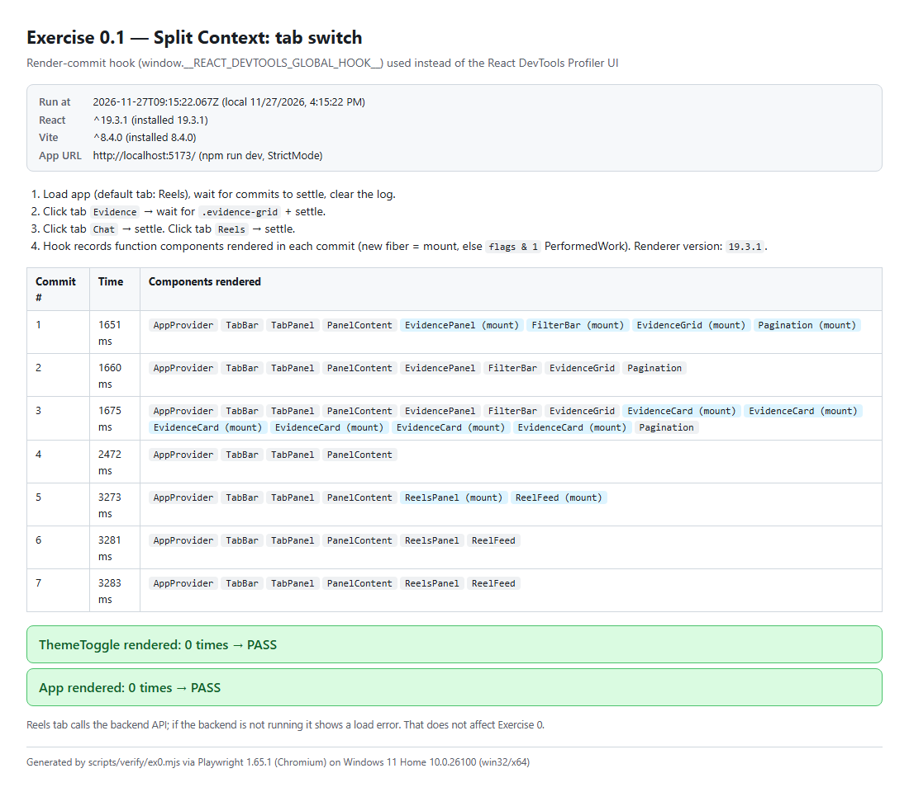

# Exercise 0.1 — Split Context Verification

**Tool:** render-commit hook — a minimal `window.__REACT_DEVTOOLS_GLOBAL_HOOK__` installed by Playwright
(`page.addInitScript`). On every `onCommitFiberRoot` it walks the fiber tree and records each function
component that actually rendered (new fiber = mount, otherwise `flags & 1` PerformedWork), the same rule
React DevTools uses. This replaces the React DevTools Profiler UI.
**Build:** `npm run dev` (React 19.3.1, Vite 8.4.0, StrictMode) · Chromium via Playwright 1.65.1 · Windows 11

**Re-run:** `npm run verify:ex0` (script: [`scripts/verify/ex0.mjs`](../../scripts/verify/ex0.mjs)). It starts the dev
server, runs the checks, regenerates the screenshots below and exits with code 1 if any check fails.

## Test A — Switch tabs (Reels → Evidence → Chat → Reels)
| Component | Expected | Measured (7 commits) | Result |
|-----------|----------|----------------------|--------|
| `App` | No render | 0 renders | ✅ PASS |
| `ThemeToggle` | No render | 0 renders | ✅ PASS |
| `TabBar` | Renders (reads `activeTab`) | rendered in every commit | ✅ as expected |
| `TabPanel` | Renders (reads `activeTab`) | rendered in every commit | ✅ as expected |

## Test B — Click the already-active tab (3×)
Expected: reducer returns the same state reference → React bails out → **0 commits**.

| Measure | Expected | Measured | Result |
|---------|----------|----------|--------|
| Commits recorded | 0 | 3 (one per click) | ❌ **FAIL** |
| Components rendered in those commits | 0 | 0 | ✅ |

React 19 does not bail out of `useReducer` before rendering: each dispatch schedules a render, the reducer
returns the same state, every component bails out, but the root is still committed. So no component
re-renders, yet the "0 commits" criterion is not met.

## Test C — Toggle theme
Not covered by `verify:ex0` (manual check).
`<html data-theme>` switches `dark ⇄ light` via `useEffect([state.theme])` in `AppProvider`.
`ThemeToggle` icon swaps through CSS `[data-theme]` selector, not React state.

## Result
- ✅ PASS: `ThemeToggle` and `App` never render on tab switch (and on page change, see Exercise 0.2).
- ❌ FAIL: clicking the active tab still produces 3 commits (with 0 component renders).

_Last run: 2026-11-27, `npm run verify:ex0`._
