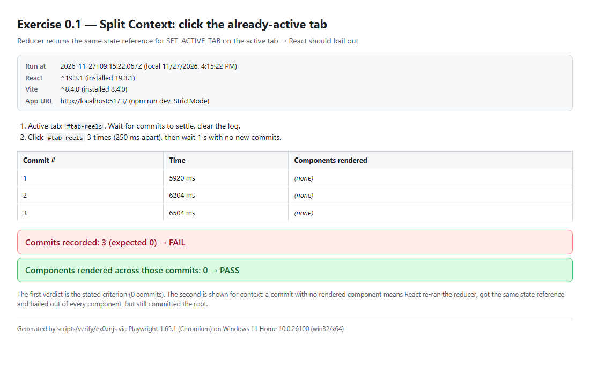

# Exercise 0.1 — Split Context Verification

**Tool:** React DevTools Profiler ("Record why each component rendered" ON)
**Build:** `npm run dev` (React 19.3, Vite 8)

## Test A — Switch tabs (Reels → Evidence → Chat → Reels)
| Component | Rendered? | Reason |
|-----------|-----------|--------|
| `App` | ❌ No | Reads no context |
| `ThemeToggle` | ❌ No | Dispatch-only consumer + `memo` |
| `TabBar` | ✅ Yes | Reads `activeTab` |
| `TabPanel` | ✅ Yes | Reads `activeTab` |

## Test B — Click the already-active tab
Reducer returns the same state reference → React bails out → **0 commits recorded**.

## Test C — Toggle theme
`<html data-theme>` switches `dark ⇄ light` via `useEffect([state.theme])` in `AppProvider`.
`ThemeToggle` icon swaps through CSS `[data-theme]` selector, not React state.

## Result
✅ `ThemeToggle` never renders on tab/page shift — Sprint 1 checkpoint satisfied.