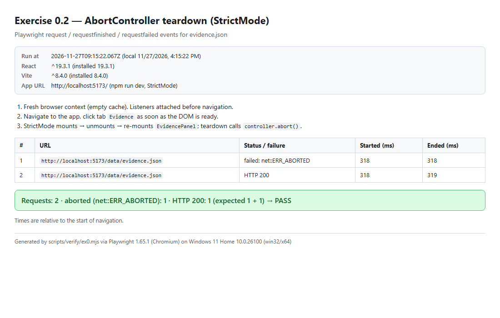
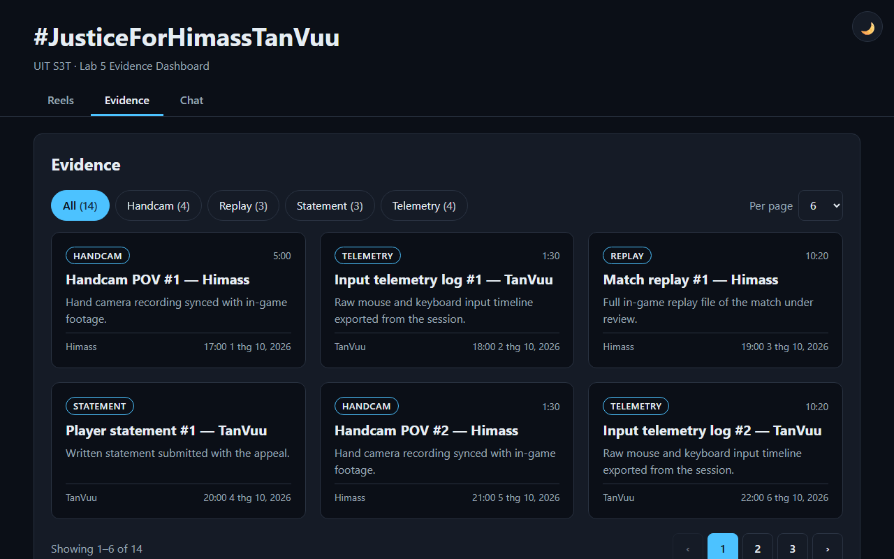
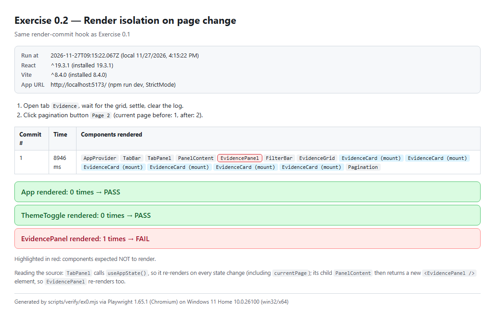
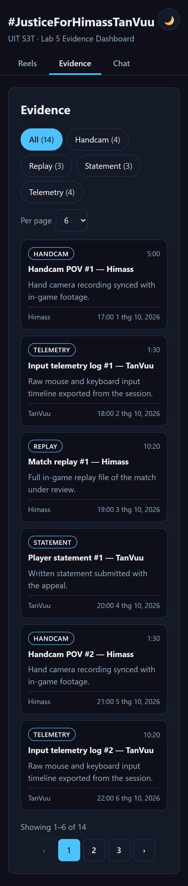

# Exercise 0.2 — Zero-Effect Pagination & Container Queries Verification

**Build:** `npm run dev` (React 19.3.1, Vite 8.4.0, StrictMode) · Dataset: `public/data/evidence.json` (14 items, 4 tags)
**Automated checks:** Playwright 1.65.1 (Chromium) on Windows 11.

**Re-run:** `npm run verify:ex0` (script: [`scripts/verify/ex0.mjs`](../../scripts/verify/ex0.mjs)). It starts the dev
server, runs the checks, regenerates the screenshots below and exits with code 1 if any check fails.

## Challenge B — Zero-Effect Filter & Pagination
_Static/manual checks; not covered by `verify:ex0`._

| Criterion | Result |
|-----------|--------|
| No secondary `useEffect` for filter/pagination | ✅ Only 2 effects in `src/`: `AppProvider` (DOM theme sync) and `useEvidenceLoader` (network) |
| Filter + slice derived via `useMemo` in render | ✅ `EvidenceGrid.jsx`, `Pagination.jsx` via pure `filterByTag` + `getPageWindow` |
| Stable keys | ✅ `key={item._id}` on every `EvidenceCard` |
| Zero console key warnings | ✅ |

Command used:
```powershell
Get-ChildItem src -Recurse -Include *.js,*.jsx | Select-String "useEffect\("
```

## Derived-state behaviour
_Manual checks; not covered by `verify:ex0`._

| Action | Expected | Result |
|--------|----------|--------|
| Page 3 → filter `replay` | Page resets to 1 inside reducer (no effect) | ✅ |
| Per page 6 → 3 | 5 pages, back to page 1 | ✅ |
| Out-of-range page | Clamped at render by `getPageWindow` | ✅ |

## AbortController teardown
Playwright records `request` / `requestfinished` / `requestfailed` for `evidence.json` in a fresh context
while the Evidence tab is opened during page load (StrictMode mount → unmount → mount).

| Expected | Measured | Result |
|----------|----------|--------|
| 1 request `net::ERR_ABORTED` + 1 request HTTP 200 | 2 requests: 1 `net::ERR_ABORTED`, 1 HTTP 200 | ✅ PASS |



Evidence tab after load (1280×800):



## Render isolation (page 1 → 2)
Same render-commit hook as Exercise 0.1 (`__REACT_DEVTOOLS_GLOBAL_HOOK__`, not the DevTools Profiler UI).

| Component | Expected | Measured | Result |
|-----------|----------|----------|--------|
| `App` | No render | 0 | ✅ PASS |
| `ThemeToggle` | No render | 0 | ✅ PASS |
| `EvidencePanel` | No render | 1 | ❌ **FAIL** |

Cause (from the source): `TabPanel` calls `useAppState()`, so it re-renders on every state change, including
`currentPage`. Its child `PanelContent` returns a new `<EvidencePanel />` element, so `EvidencePanel` renders
again, even though it reads no state itself.



## Responsive (container queries)
| Container width | Columns |
|-----------------|---------|
| < 34rem | 1 |
| ≥ 34rem | 2 |
| ≥ 54rem | 3 |

No fixed-width container; `100dvh` shell; all controls ≥ 44×44px.

Mobile check at 375×812 (deviceScaleFactor 2):

| Check | Measured | Result |
|-------|----------|--------|
| No horizontal scroll (`scrollWidth <= innerWidth`) | 375 ≤ 375 | ✅ PASS |
| Grid is 1 column (`gridTemplateColumns`) | `293px` → 1 column | ✅ PASS |



_Last run: 2026-11-27, `npm run verify:ex0`._
